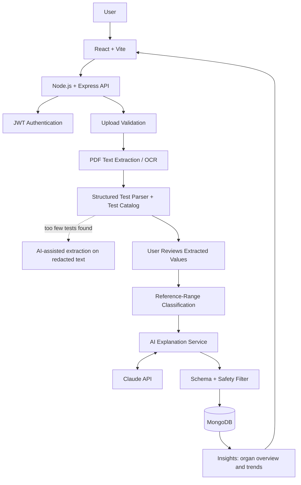
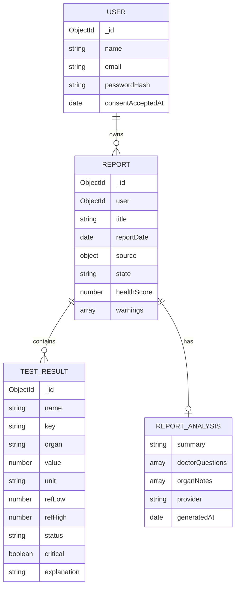

<div align="center">

# 🩺 AI Health Report Translator

### Medical reports, explained in simple language.

hello team.


**Understand the report. Verify the values. Ask better questions.**

</div>

---

> ⚕️ **Important:** This is an educational tool, not a diagnostic system. It does not diagnose conditions or recommend treatment. Always discuss medical results with a qualified healthcare professional.

## ✨ What it does?

Upload a laboratory report, review the extracted test details, understand terminology in plain language, and revisit results over time.

- 📄 **Upload reports**: PDF, JPG, PNG and WEBP. Text is read directly from PDFs, and OCR is used for scans and photos.
- 🔎 **Review results**: check and correct every extracted value before analysis, then see each one marked **Normal**, **High** or **Low** against the range printed on the report.
- 🧍 **Interactive body map**: every test is linked to a body area (brain, thyroid, heart, lungs, liver, pancreas, kidneys, blood, bones). Areas glow by status, pulse when they need attention, and open into an organ page with a card per test.
- 🤖 **Understand the terms**: plain-language explanations for each test and a short summary of the whole report.
- 💬 **Prepare for appointments**: suggested questions to discuss with a healthcare professional.
- 📈 **Track trends**: charts of the same test across saved reports, with the reference range shaded.
- 🔐 **Keep reports private**: authenticated accounts, user-scoped access, no stored files, and delete-everything at any time.

## 🧰 Technology:-

| Layer | Tools used |
|---|---|
| Frontend | React 19, Vite, JavaScript, HTML, CSS, React Router |
| UI & charts | Lucide React, Recharts, Framer Motion, custom SVG body map |
| Backend | Node.js, Express 5, REST APIs |
| Database | MongoDB with Mongoose |
| Authentication | JWT (jsonwebtoken), bcryptjs |
| Uploads | Multer (in-memory, type, size and content checks) |
| PDF & OCR | pdf-parse, Tesseract.js (English data bundled, works offline) |
| AI | Claude API (`@anthropic-ai/sdk`), with an offline rule-based fallback |
| Validation & security | zod, helmet, express-rate-limit, CORS |
| Testing | node:test, supertest, Playwright for browser checks |

## 🏗️ System architecture:-



### 🔄 Report workflow:-

**Sign in → Upload → Extract → Review → Classify → Explain → Save → Track trends**

1. Validate the uploaded file (type, size and real file content).
2. Extract PDF text, or run OCR on scanned PDFs and photos.
3. Parse test names, values, units and reference ranges, and link each test to a body area.
4. Let the user correct extracted details before analysis.
5. Classify numeric results as **Normal**, **High** or **Low** in code, using the report's own range.
6. Generate educational AI explanations, validate them, and replace anything unsafe.
7. Save the report and show its history, organ overview and trends.

## 🗃️ Data model:-

Implemented in `server/src/models`. Test results and the analysis are stored inside the report document.



**Core entities**
- **User:** account, password hash and disclaimer consent time.
- **Report:** owner, title, date, source (PDF, image or manual, original file name only), state (`pending_review` or `analyzed`) and a health score.
- **TestResult:** value, unit, reference range, status, normalised `key` for trends, linked `organ`, critical flag and explanation.
- **ReportAnalysis:** summary, doctor questions, a note per body area and which AI provider produced it.

## 🔌 API endpoints

All routes start with `/api`. Protected routes need `Authorization: Bearer <token>`.

| Method | Endpoint | Purpose |
|---|---|---|
| `POST` | `/api/auth/register` | Create an account (`acceptDisclaimer: true` required) |
| `POST` | `/api/auth/login` | Sign in and receive a JWT |
| `GET` | `/api/auth/me` | Get current user |
| `PATCH` | `/api/auth/me` | Update profile |
| `DELETE` | `/api/auth/me` | Delete the account and all reports |
| `POST` | `/api/reports/upload` | Upload a report (multipart field `file`) |
| `POST` | `/api/reports/manual` | Create a report from typed values |
| `GET` | `/api/reports` | List the user's reports |
| `GET` | `/api/reports/:id` | View a report |
| `PUT` | `/api/reports/:id` | Correct extracted values (re-classifies) |
| `POST` | `/api/reports/:id/analyze` | Generate educational analysis |
| `DELETE` | `/api/reports/:id` | Delete a report |
| `GET` | `/api/insights/overview` | Latest values per body area (powers the body map) |
| `GET` | `/api/insights/trends` | List tracked tests |
| `GET` | `/api/insights/trends/:key` | View comparable results over time |
| `GET` | `/api/catalog` | Known tests and body areas |
| `GET` | `/api/health` | Server status and AI mode |

## 🔐 Privacy & responsible AI

- Passwords are bcrypt hashes; plaintext passwords are never stored.
- Report ownership is checked on **every** read, update, analysis and delete request.
- Uploads are checked for type, size and real content (magic bytes), then processed in memory and discarded. Only test values are saved.
- Database credentials and API keys live in environment variables.
- Only test names, values, units, ranges and statuses are sent to the AI. If AI-assisted extraction is needed, names, phone numbers, emails and IDs are redacted first.
- AI output must match a JSON schema and pass a safety filter that blocks diagnoses and medicine or dosage advice. Anything that fails is replaced with cautious built-in text.
- Normal / High / Low is decided in code, never by the AI.
- Values far outside safe limits show a "contact a doctor promptly" banner.
- A clear medical disclaimer is shown with every analysis, and users accept it at sign-up.
- Login and AI routes are rate limited, and logs never contain health data.
- Testing uses synthetic reports only (`server/samples`).

**Limitations:** OCR and parsing can make mistakes. The app uses the range printed on the report, not age- or sex-specific ranges. Qualitative results (for example "Negative") are shown but not graded. Trends are meaningful only when test names and units are comparable. AI explanations may be incomplete or inaccurate; users should verify values and consult a qualified professional.

## 🧪 Testing checklist

Run with `cd server && npm test` (needs MongoDB). 15 automated tests currently pass.

- [x] Range boundaries, one-sided ranges, missing values and qualitative results
- [x] Authentication, invalid tokens and access control between users
- [x] Upload validation and error handling
- [x] PDF and OCR → parsing → review → classification → analysis
- [x] Report history, deletion, account deletion and trends
- [x] AI output checks for unsupported diagnoses or treatment advice
- [ ] Live Claude responses with a real API key
- [ ] Usability feedback from peers

## 🗺️ Development roadmap

- [x] **Weeks 1–4:** Requirements, architecture, schema, API design, wireframes
- [x] **Weeks 5–6:** Project setup, authentication, dashboard, uploads
- [x] **Weeks 7–9:** PDF/OCR extraction, parsing, review, classification
- [x] **Weeks 10–11:** AI explanations, summaries, validation
- [x] **Weeks 12–13:** Report history and trend charts
- [ ] **Weeks 14–16:** Security review, testing with real (anonymised) layouts, refinement, deployment, documentation

## 👥 Team

| Member | Responsibility |
|---|---|
| **Kritika Yadav** | Team Lead, Backend & APIs |
| **Anubhavi Sinha** | Frontend & Data Visualisation |
| **Kumari Bhavya Singh** | PDF/OCR & AI Integration |
| **Aditya Mishra** | Database, Testing & Documentation |

**Supervisor:** Meghna M, Technical Trainer, CEA, GLA University, Mathura.

## 🚀 Local setup

**Prerequisites:** Node.js 20 or newer, npm, Git, and MongoDB (local install or a free MongoDB Atlas cluster). A Claude API key is optional.

```bash
# Clone the repository
git clone <YOUR_REPOSITORY_URL>
cd ai-health-report-translator

# Backend
cd server
npm install
cp .env.example .env        # on Windows: copy .env.example .env
npm run seed                # optional demo data
npm run dev                 # API on http://localhost:5000

# Frontend (in a second terminal)
cd client
npm install
npm run dev                 # app on http://localhost:5173
```

Edit `server/.env`:

```env
PORT=5000
MONGO_URI=mongodb://127.0.0.1:27017/ai_health_reporter   # or your Atlas connection string
JWT_SECRET=replace_with_a_long_random_secret
ANTHROPIC_API_KEY=                                        # optional; leave empty for offline mode
AI_MODEL=claude-opus-5-5
```

**Logging in:** open http://localhost:5173 and create an account, or use the demo account from `npm run seed`: `demo@example.com` / `Demo12345`. To try an upload, use `server/samples/sample-report.pdf` or `sample-report.png`.

**Without an API key**, the app runs in offline mode. Explanations, summaries and questions come from the built-in test catalog with fixed, cautious wording.

**With Docker** (optional): `docker compose up --build`, then open http://localhost:8080.

**Never commit `.env` files or real credentials.**

## 📁 Project structure

```text
ai-health-report-translator/
├── client/                      # React + Vite frontend
│   └── src/
│       ├── api/                 # API client
│       ├── context/             # auth state
│       ├── components/          # BodyMap, OrganArt, gauges, cards
│       ├── lib/                 # organ colours, formatting
│       └── pages/               # Dashboard, Organ, Upload, Review, Report, Trends, Settings
├── server/                      # Node.js + Express backend
│   ├── src/
│   │   ├── config/
│   │   ├── middleware/          # auth, upload, validation, errors
│   │   ├── routes/
│   │   ├── controllers/         # auth, reports, insights
│   │   ├── services/            # textExtractor, labParser, testCatalog, classifier, anonymizer, aiService
│   │   ├── models/              # User, Report
│   │   └── utils/
│   ├── scripts/seed.js          # demo account with 4 synthetic reports
│   ├── samples/                 # synthetic sample reports
│   ├── tests/
│   └── .env.example
├── docker-compose.yml
├── .gitignore
└── README.md
```

## 📚 References

- [React](https://react.dev/) · [Vite](https://vite.dev/guide/)
- [Node.js](https://nodejs.org/docs/latest/api/) · [Express](https://expressjs.com/)
- [MongoDB](https://www.mongodb.com/docs/manual/) · [Multer](https://github.com/expressjs/multer)
- [Recharts](https://recharts.org/) · [Lucide React](https://lucide.dev/guide/packages/lucide-react)
- [JWT, RFC 7519](https://www.rfc-editor.org/rfc/rfc7519) · [Tesseract OCR](https://github.com/tesseract-ocr/tesseract)
- [Claude API documentation](https://docs.claude.com/)
- [OWASP Top Ten](https://owasp.org/www-project-top-ten/) · [Digital Personal Data Protection Act, 2023](https://www.meity.gov.in/)

## 🤝 Contributing

Suggestions and bug reports are welcome. Include tests for parsing, classification and AI output changes. Never attach real patient reports or personal medical data to issues or pull requests.

## 📄 License

No license has been specified yet. Add a `LICENSE` file before distributing the project.

---

<div align="center">

**Built as an academic project at GLA University, Mathura.**

*Making laboratory reports easier to understand, without replacing professional medical advice.*

</div>
