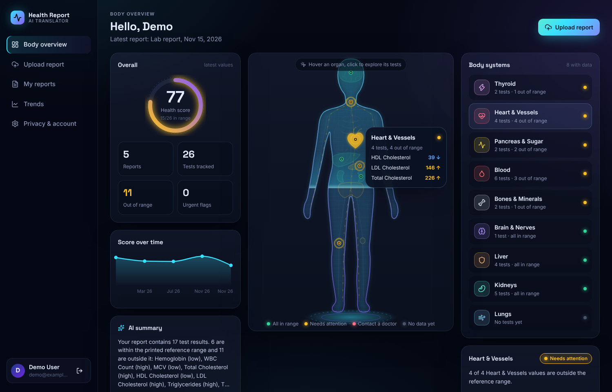
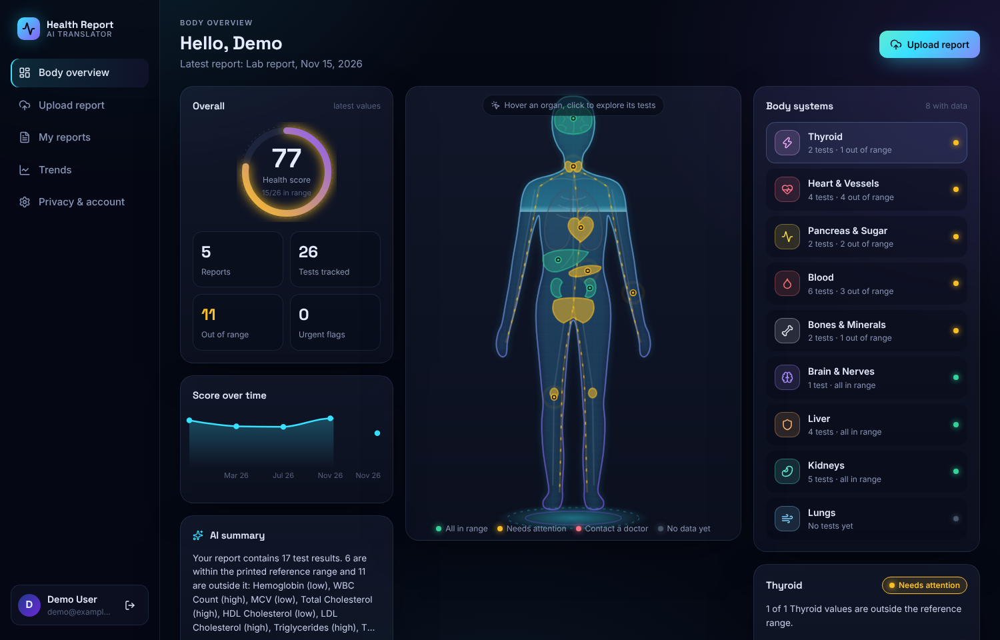
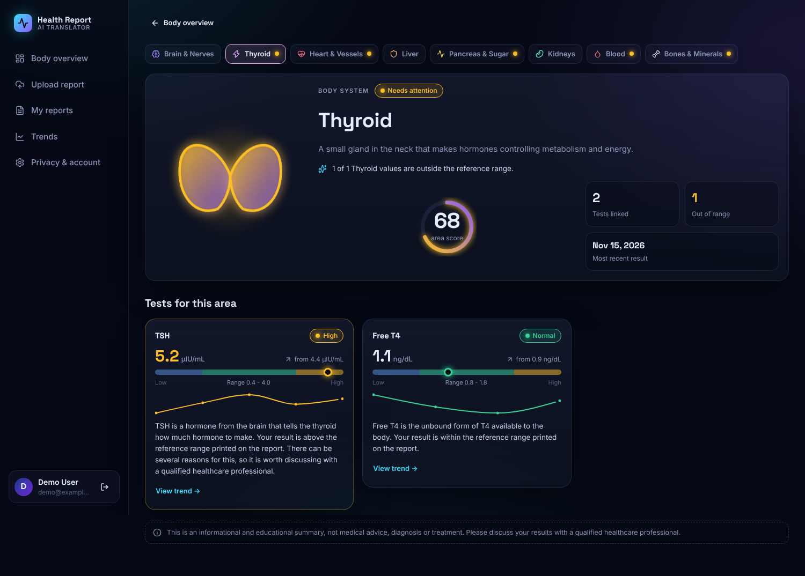
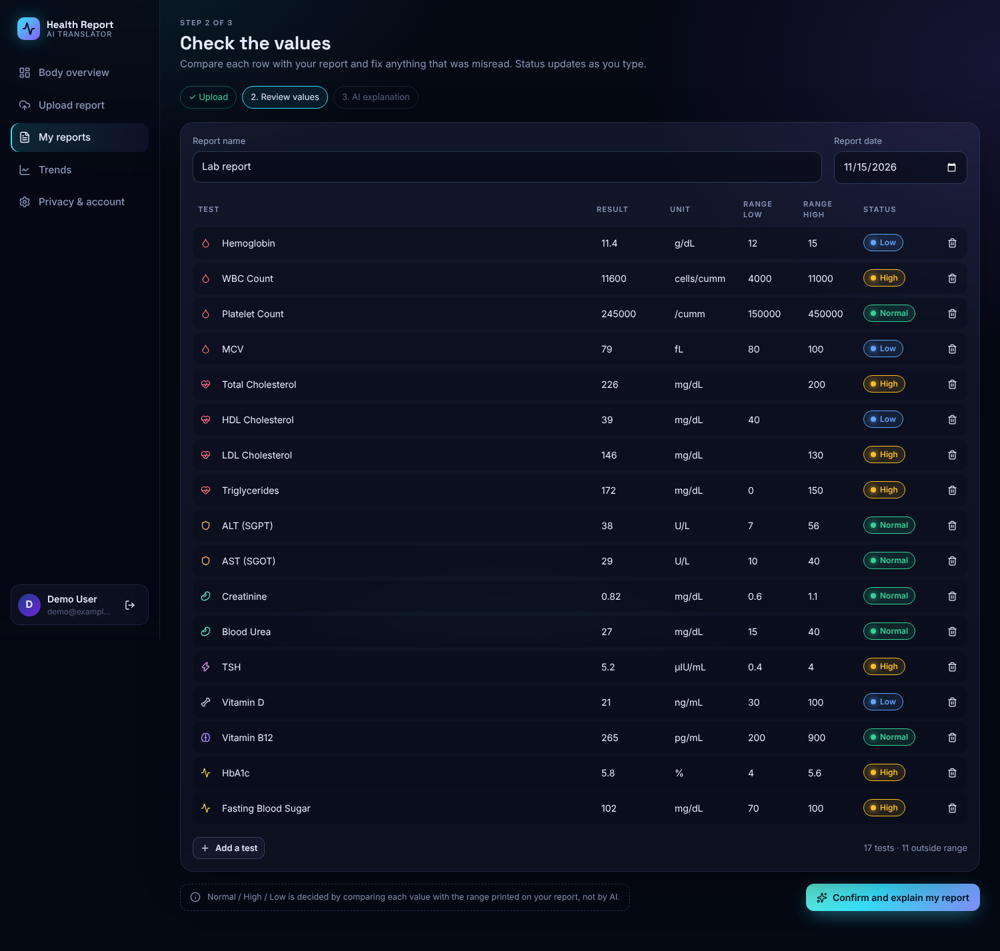
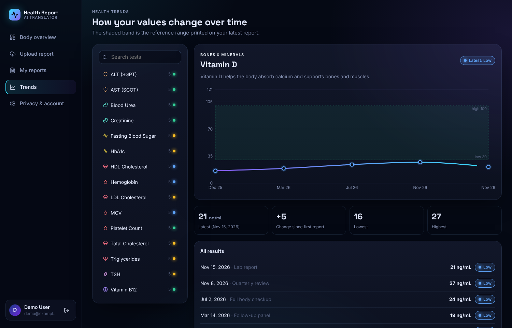

# AI Health Report Translator

An AI-powered web application that turns medical laboratory reports into plain language, flags values outside the printed reference range, links every test to the body area it relates to, and tracks how values change over time.

> **Not medical advice.** The app is an informational and educational tool. It does not diagnose, recommend treatment, or replace a qualified healthcare professional. Every analysis screen shows this disclaimer.

GLA University mini project, Team 33.



## Features

| Synopsis feature | Where it lives |
| --- | --- |
| User authentication (JWT, bcrypt) | `server/src/controllers/authController.js`, `server/src/middleware/auth.js` |
| Report upload (PDF, JPG, PNG, WEBP) with validation | `server/src/middleware/upload.js` (type, size and magic-byte checks) |
| PDF text extraction and OCR for scans and photos | `server/src/services/textExtractor.js` (pdf-parse, Tesseract.js, offline language data) |
| Extraction of test names, values, units and ranges | `server/src/services/labParser.js` (pattern-based), AI-assisted fallback in `aiService.js` |
| User verification of extracted values | Review screen `client/src/pages/ReviewPage.jsx` |
| Normal / High / Low classification in code, not AI | `server/src/services/classifier.js` |
| Plain-language explanations, summary, doctor questions | `server/src/services/aiService.js` (Claude API, strict JSON schema, safety filter) |
| Organ mapping for the interactive body view | `server/src/services/testCatalog.js` (56 tests, 9 body areas) |
| Trend tracking and charts | `server/src/controllers/insightController.js`, `client/src/pages/TrendsPage.jsx` |
| Report history and deletion, account deletion | Reports and Privacy pages |

### The interactive body view

- A holographic body map shows each body area (brain, thyroid, heart, lungs, liver, pancreas, kidneys, blood, bones) coloured by the status of its latest results. Areas that need attention pulse.
- Hover an organ to see its out-of-range values. Click to open the organ page with an illustration, an area score, and a card per test (gauge against the reference range, change since last report, sparkline, explanation).
- Unknown tests still appear, grouped under "Other tests".

## Architecture

```
React (Vite) client  ──/api──▶  Express REST API  ──▶  MongoDB
  body map, charts                │
  (Recharts, Framer Motion)       ├─ textExtractor   (pdf-parse, Tesseract OCR)
                                  ├─ labParser       (regex parsing + catalog)
                                  ├─ classifier      (Normal / High / Low, score)
                                  └─ aiService       (Claude API, or offline rules)
```

Workflow: register/login → upload → text extraction → parsing → **user review** → classification → AI explanation → storage → trends.

### Folder structure

```
server/
  src/config        env + database
  src/models        User, Report (embedded results + analysis)
  src/middleware    auth, upload, validation, errors
  src/services      testCatalog, labParser, classifier, textExtractor, anonymizer, aiService, reportPipeline
  src/controllers   auth, reports, insights (overview, trends)
  scripts/seed.js   demo account with 4 synthetic reports
  samples/          synthetic sample report (PDF + PNG) and the script that makes them
  tests/            unit + API tests (node:test, supertest)
client/
  src/components    BodyMap (SVG anatomy), OrganArt, UI kit (gauge, score ring, cards)
  src/pages         Auth, Dashboard, Organ, Upload, Review, Report, Reports, Trends, Settings
```

## Getting started

Requirements: Node.js 20+ and MongoDB (local install, Docker, or MongoDB Atlas).

```bash
# 1. API
cd server
cp .env.example .env          # set JWT_SECRET; ANTHROPIC_API_KEY is optional
npm install
npm run seed                  # optional demo data: demo@example.com / Demo12345
npm run dev                   # http://localhost:5000/api/health

# 2. Web app (new terminal)
cd client
npm install
npm run dev                   # http://localhost:5173
```

Or run everything with Docker:

```bash
cp server/.env.example server/.env   # set JWT_SECRET
docker compose up --build            # web on http://localhost:8080
```

Try it with `server/samples/sample-report.pdf` or `sample-report.png` (synthetic data).

### AI provider

Set `ANTHROPIC_API_KEY` in `server/.env` to use Claude (`AI_MODEL`, default `claude-opus-5-5`). Without a key the app runs in **offline mode**: explanations, summaries and doctor questions are generated from the test catalog with fixed, cautious wording. Everything else works the same, which keeps development and demos free.

## API

All routes are under `/api`. Protected routes need `Authorization: Bearer <token>`.

| Method | Route | Purpose |
| --- | --- | --- |
| POST | `/auth/register` | Create account (`name`, `email`, `password`, `acceptDisclaimer: true`) |
| POST | `/auth/login` | Log in, returns a JWT |
| GET / PATCH / DELETE | `/auth/me` | Profile, update name, delete account and all data |
| POST | `/reports/upload` | Multipart `file` (+ optional `title`, `reportDate`) → extracted, `pending_review` |
| POST | `/reports/manual` | Create a report from typed values |
| GET | `/reports`, `/reports/:id` | List / view reports |
| PUT | `/reports/:id` | Save reviewed values (re-classifies) |
| POST | `/reports/:id/analyze` | Classify + AI explanation → `analyzed` |
| DELETE | `/reports/:id` | Delete a report |
| GET | `/insights/overview` | Per-organ latest values, status, score, history (powers the body map) |
| GET | `/insights/trends`, `/insights/trends/:key` | Tracked parameters / points for one test |
| GET | `/catalog` | Known tests and body areas |

## Safety and privacy design

- **Classification is deterministic.** Normal / High / Low comes from comparing the value with the printed range in code. The AI never changes it.
- **Non-diagnostic AI.** The prompt forbids diagnoses, disease names as conclusions, medicines and dosages. Output must match a JSON schema, and every sentence passes a safety filter (`isSafe`); anything that fails is replaced with cautious offline text.
- **Urgent values.** A small rule table flags values far outside safe limits (for example potassium ≥ 6.5 mmol/L) with a "contact a doctor promptly" banner.
- **Data minimisation.** Uploaded files are processed in memory and never stored. Only test values are saved. Only test names, values, units, ranges and statuses are sent to the AI. If AI-assisted extraction is needed, names, phone numbers, emails and IDs are redacted first (`anonymizer.js`).
- **Access control.** Every query is filtered by the logged-in user. Passwords are bcrypt hashes, tokens expire (2h default), login and AI routes are rate limited, inputs are validated with zod, uploads are checked by magic bytes, and logs never contain request bodies.
- **User control.** Users can edit values, delete reports, and delete their account with all data.

Limitations (from the synopsis): unusual layouts and poor scans reduce extraction accuracy, the app uses the range printed on the report (not age- or sex-specific ranges), qualitative results are shown but not graded, and values in different units may not be comparable in trends.

## Testing

```bash
cd server
npm test     # needs MongoDB; uses MONGO_URI_TEST or mongodb://127.0.0.1:27017/ai_health_reporter_test
```

15 tests cover the parser (including the synopsis WBC example), classification, critical flags, the safety filter, redaction, auth, file validation, the full upload → review → analyze → trends → overview workflow, image OCR, access control between users, and account deletion.

## Screenshots

| | |
| --- | --- |
|  |  |
|  |  |
