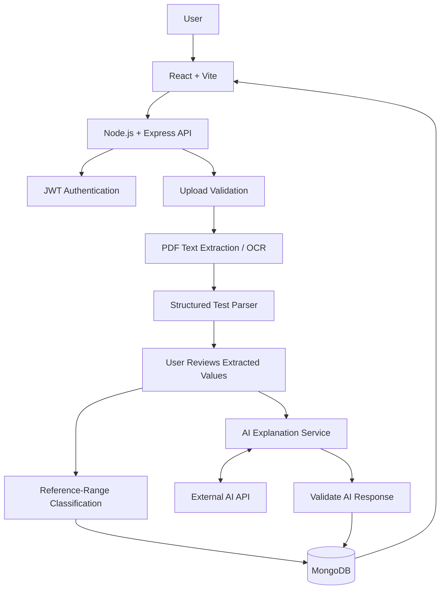
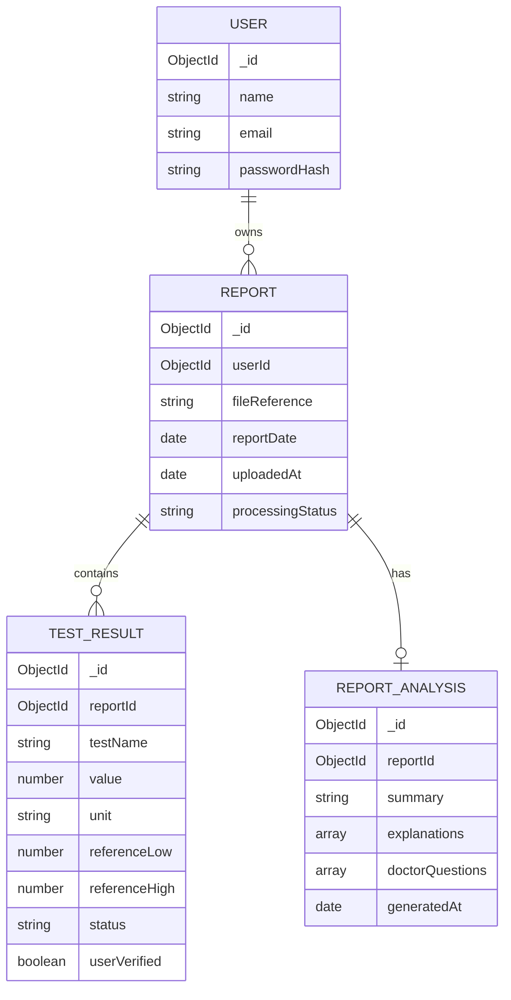

<div align="center">

# 🩺 AI Health Report Translator

### Medical reports, explained in simple language.

hello team.


**Understand the report. Verify the values. Ask better questions.**

</div>

---

> ⚕️ **Important:** This is an educational tool, not a diagnostic system. It does not diagnose conditions or recommend treatment. Always discuss medical results with a qualified healthcare professional.

## ✨ What it does?

Upload a laboratory report, review the extracted test details, understand terminology in plain language, and revisit results over time.

- 📄 **Upload reports** — PDF, JPG, and PNG; extract text or use OCR for scans.
- 🔎 **Review results** — compare numeric values with the reference ranges printed on the report.
- 🤖 **Understand the terms** — generate plain-language explanations and a concise summary.
- 💬 **Prepare for appointments** — get suggested questions to discuss with a healthcare professional.
- 📈 **Track trends** — view comparable test results across saved reports.
- 🔐 **Keep reports private** — authenticated accounts and user-scoped report access.

## 🧰 Technology:-

| Layer | Planned tools |
|---|---|
| Frontend | React, Vite, JavaScript, HTML, CSS |
| UI & charts | Lucide React, Recharts |
| Backend | Node.js, Express, REST APIs |
| Database | MongoDB |
| Authentication | JWT, bcrypt (or equivalent password hashing) |
| Uploads | Multer |
| PDF & OCR | PDF text-extraction library, Tesseract or equivalent |
| AI | LLM API provider to be finalised |
| Testing | Git, GitHub, Postman, browser testing |

*The stack reflects the project plan. Update it to match the libraries and services actually implemented.*

## 🏗️ System architecture:-



### 🔄 Report workflow:-

**Sign in → Upload → Extract → Review → Classify → Explain → Save → Track trends**

1. Validate the uploaded file.
2. Extract PDF text or run OCR on scanned reports.
3. Parse test names, values, units, and reference ranges.
4. Let the user correct extracted details before analysis.
5. Classify numeric results as **Normal**, **High**, or **Low** using the report's own range.
6. Generate and validate educational AI explanations.
7. Save the report and show its history and comparable trends.

## 🗃️ Proposed data model:-

The following is a **logical design**, not a claim that these schemas are already implemented.



**Core entities**
- **User:** account and password hash.
- **Report:** owner, file metadata, dates, and processing status.
- **TestResult:** extracted value, unit, reference range, classification, and verification status.
- **ReportAnalysis:** summary, explanations, and suggested doctor questions.

## 🔌 Planned API endpoints

These are proposed contracts; verify them against the routes in the implementation.

| Method | Endpoint | Purpose |
|---|---|---|
| `POST` | `/api/auth/register` | Create an account |
| `POST` | `/api/auth/login` | Sign in and receive a JWT |
| `GET` | `/api/auth/me` | Get current user |
| `POST` | `/api/reports` | Upload a report |
| `GET` | `/api/reports` | List the user's reports |
| `GET` | `/api/reports/:reportId` | View a report |
| `PATCH` | `/api/reports/:reportId/results` | Correct extracted values |
| `POST` | `/api/reports/:reportId/analyze` | Generate educational analysis |
| `DELETE` | `/api/reports/:reportId` | Delete a report |
| `GET` | `/api/trends/:testName` | View comparable results over time |

## 🔐 Privacy & responsible AI

- Hash passwords; never store plaintext passwords.
- Check report ownership on **every** read, update, analysis, and delete request.
- Validate uploaded file types, content, and size.
- Keep database credentials and API keys in environment variables.
- Send only the minimum necessary data to external AI services.
- Validate AI output and keep explanations grounded in verified report values.
- Display a clear medical disclaimer with every analysis.
- Use synthetic or properly anonymised reports for testing.

**Limitations:** OCR and parsing can make mistakes. Reference ranges vary, and trends are meaningful only when test names and units are comparable. AI explanations may be incomplete or inaccurate; users should verify values and consult a qualified professional.

## 🧪 Testing checklist

- [ ] Range boundaries, missing values, and qualitative results
- [ ] Authentication, invalid tokens, and access control
- [ ] Upload validation and error handling
- [ ] PDF/OCR → parsing → review → classification → AI validation
- [ ] Report history, deletion, and trend charts
- [ ] AI output checks for unsupported diagnoses or treatment advice

## 🗺️ Development roadmap

- [ ] **Weeks 1–4:** Requirements, architecture, schema, API design, wireframes
- [ ] **Weeks 5–6:** Project setup, authentication, dashboard, uploads
- [ ] **Weeks 7–9:** PDF/OCR extraction, parsing, review, classification
- [ ] **Weeks 10–11:** AI explanations, summaries, validation
- [ ] **Weeks 12–13:** Report history and trend charts
- [ ] **Weeks 14–16:** Security, testing, refinement, deployment, documentation

## 👥 Team

| Member | Responsibility |
|---|---|
| **Kritika Yadav** | Team Lead, Backend & APIs |
| **Anubhavi Sinha** | Frontend & Data Visualisation |
| **Kumari Bhavya Singh** | PDF/OCR & AI Integration |
| **Aditya Mishra** | Database, Testing & Documentation |

**Supervisor:** Meghna M — Technical Trainer, CEA, GLA University, Mathura.

## 🚀 Local setup

**Prerequisites:** Node.js LTS, npm, Git, MongoDB or MongoDB Atlas, and the chosen AI provider's credentials.

```bash
# Clone the repository
git clone <YOUR_REPOSITORY_URL>
cd <YOUR_PROJECT_DIRECTORY>

# Install backend dependencies
cd backend
npm install

# If the frontend is separate
cd ../frontend
npm install
```

Create `.env` files using the variable names your code expects. Example only:

```env
PORT=5000
MONGODB_URI=your_mongodb_connection_string
JWT_SECRET=replace_with_a_long_random_secret
AI_API_KEY=your_ai_provider_key
```

Check each `package.json` for the correct start scripts. **Never commit `.env` files or real credentials.**

## 📁 Suggested project structure

```text
ai-health-report-translator/
├── frontend/
│   └── src/
│       ├── components/
│       ├── pages/
│       ├── services/
│       └── charts/
├── backend/
│   └── src/
│       ├── config/
│       ├── middleware/
│       ├── routes/
│       ├── controllers/
│       ├── services/
│       │   ├── pdf/
│       │   ├── ocr/
│       │   └── ai/
│       ├── models/
│       └── utils/
├── tests/
├── .env.example
├── .gitignore
└── README.md
```

*Suggested structure only; adapt it to the actual repository.*

## 📚 References

- [React](https://react.dev/) · [Vite](https://vite.dev/guide/)
- [Node.js](https://nodejs.org/docs/latest/api/) · [Express](https://expressjs.com/)
- [MongoDB](https://www.mongodb.com/docs/manual/) · [Multer](https://github.com/expressjs/multer)
- [Recharts](https://recharts.org/) · [Lucide React](https://lucide.dev/guide/packages/lucide-react)
- [JWT — RFC 7519](https://www.rfc-editor.org/rfc/rfc7519) · [Tesseract OCR](https://github.com/tesseract-ocr/tesseract)
- [OWASP Top Ten](https://owasp.org/www-project-top-ten/) · [Digital Personal Data Protection Act, 2023](https://www.meity.gov.in/)

## 🤝 Contributing

Suggestions and bug reports are welcome. Include tests for parsing, classification, and AI output changes. Never attach real patient reports or personal medical data to issues or pull requests.

## 📄 License

No license has been specified yet. Add a `LICENSE` file before distributing the project.

---

<div align="center">

**Built as an academic project at GLA University, Mathura.**

*Making laboratory reports easier to understand — without replacing professional medical advice.*

</div>
